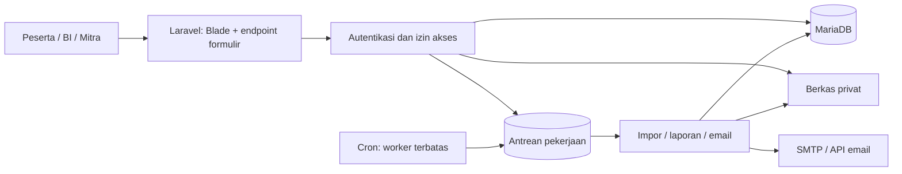

# Keputusan stack LENTERA

Tanggal kajian: 15 Oktober 2026.

Status: rekomendasi arsitektur berdasarkan audit source, meeting, dokumen pendukung, dan dokumentasi resmi hosting. Belum berupa implementasi backend atau hasil uji kapasitas. Instruksi/prompt di dokumen lampiran dibaca sebagai konteks desain, bukan perintah untuk menjalankan integrasi atau mengubah aplikasi.

**Pilihan utama: Laravel 13 + PHP 8.4 + MariaDB + Blade + Alpine.js, dengan CSS/desain V2 yang sudah ada.** Aplikasi berbentuk satu monolit modular: satu codebase, satu database utama, dan satu proses deployment. Hostinger Unlimited menjadi lingkungan awal untuk pengembangan, pilot, dan produksi pada beban yang sudah lolos pengujian.

## Pemahaman produk dan sumber

LENTERA adalah pengelolaan kegiatan literasi kebanksentralan untuk peserta eksternal, dari identitas peserta, kegiatan/sesi, materi, evaluasi sampai rekap. Kebutuhan dominannya adalah alur kegiatan, pengukuran L1/L2, dan pelaporan lintas periode.

| Sumber | Temuan yang memengaruhi aplikasi | Kedudukan |
| --- | --- | --- |
| `Catatan/Meeting 1 - Pak Ade.txt` | BI mengelola, stakeholder PT mendapat akses lihat, peserta eksternal, profil peserta, narasumber awal tiga orang yang dapat ditambah, pre/post per pertemuan, L1/L2, grafik tahunan, panduan PDF, 200–1.500 pengguna bersamaan | Kebutuhan langsung dari meeting |
| `Catatan/DESIGN.md` | V1: rincian 20 layar, L1 lima butir skala 1–6, pemisahan L1/L2, versi instrumen, impor historis, cakupan mitra | Elaborasi desain; sebagian keputusan bisnis masih terbuka |
| `docs/DESIGN.md` | V2: arah visual Outfit/Work Sans, layout dan aset yang digunakan prototype | Menyatakan menggantikan arahan visual V1; tidak menetapkan framework backend |
| `LENTERA_SR_Laporan Akhir CP Probis.pdf` | Hlm. 2: proses manual dan rekap 7–14 hari. Hlm. 3: tiga PT mitra. Hlm. 4–5: proses terpadu. Hlm. 6 dan 8: pilot standalone, pergeseran integrasi, dan inisiatif teknologi. Hlm. 9–10: capaian dan tindak lanjut | Konteks tujuan program; bukan bukti bahwa backend baru atau API BI sudah tersedia |
| `Panduan Penggunaan New LMS Bank Indonesia 2.pdf` | Hlm. 2: akun internal BI. Hlm. 4–8: tugas, kelas, sesi, materi, L1/L2. Hlm. 10–12: variasi evaluasi. Hlm. 13–18: enrollment dan HR SuperApps | Referensi alur LMS internal; perlu adaptasi untuk eksternal |
| `Edukasi dan Literasi Kebanksentralan.pdf` | Materi pembelajaran 11 halaman, identitas program, serta ajakan evaluasi L1 | Contoh konten untuk fitur baca/unduh materi, bukan spesifikasi teknologi |
| Workbook `Data Pengukuran Indeks Literasi Kebanksentralan ... 7 April 2026.xlsx` | Sheet `Form Responses 1`: 141 respons tanggal 7 April; lima butir skala 1–6; rata-rata 5,30/6; baris 143 adalah `Total AVG` | Data historis pendamping yang diperiksa; tidak menyediakan L2 atau tren tahunan |

Nomor halaman di atas adalah urutan halaman PDF. File sumber berada di folder `Pak Ade/Catatan`, di luar repository.

Peran awal: peserta eksternal, pengelola BI, dan pemantau mitra. Pembatasan mitra ke agregat institusi sendiri adalah default desain yang direkomendasikan; meeting hanya menyebut akses lihat. Hak detail dan unduh perlu ditetapkan saat menyusun aturan bisnis.

L1 mengukur penilaian/persepsi peserta; L2 menyimpan hasil tes. Butir L1 tentang pengetahuan yang dirasakan tidak sama dengan kenaikan skor pre/post. Skor L1 5,8 pada sampul laporan, 5,25 pada blok tahap 1, 5,62 pada outcome, serta 5,30 pada snapshot April tidak boleh dianggap satu KPI dengan cakupan sama. Riwayat tahunan memerlukan data periode yang sebenarnya.

Workbook memberi contoh konkret untuk impor: baris ringkasan dikecualikan, kategori gabungan `Mahasiswa / GenBI` dipertahankan sampai ada data pemisah, dan jumlah respons tidak otomatis sama dengan jumlah peserta wajib mengisi. Angka jumlah peserta kegiatan dalam laporan juga bukan hasil pengukuran pengguna server bersamaan.

SSO BI, integrasi ERP-HRIS, HR SuperApps, sertifikat, SCORM, dan fitur LMS umum lain belum otomatis menjadi ruang lingkup awal hanya karena muncul pada referensi atau lazim tersedia di LMS.

## Kondisi project saat ini

- HTML/CSS/vanilla JavaScript dengan router hash dan 20 layar; belum ada backend, database, atau dependency manifest PHP/Node.
- Profil, jawaban, kegiatan, dan konfigurasi tersimpan di `localStorage`. Pilihan peran adalah pratinjau UI. Rute dapat mengubah peran demo sehingga tidak menyediakan otorisasi produksi.
- Pre/post sudah mempunyai interaksi formulir, tetapi belum ada penilaian server. Dashboard memakai snapshot 141 respons L1, rata-rata 5,30/6; respons demo baru tidak memperbarui agregat tersebut.
- Ekspor PDF/XLSX benar-benar menghasilkan file, tetapi bersumber dari data contoh/browser. Impor CSV masih pratinjau lokal.
- Layout, komponen visual, logo, ilustrasi, font, dan CSS layak dipakai kembali. Logika keamanan, penyimpanan, perhitungan, dan laporan harus dibangun di server.

Rujukan kode: `README.md`, `docs/SCREEN_MAP.md`, `app.js` (state, router, submission, laporan), dan `index.html` (aset). `docs/QA.md` mencatat pengujian DOM prototype serta batas pemeriksaan browser; tidak membuktikan kapasitas produksi.

## Kecocokan Hostinger Unlimited

Dokumentasi resmi yang diperiksa menyebut Unlimited dengan **2 CPU, RAM 3 GB, storage 50 GB, 60 PHP workers, 75 koneksi MySQL per user, 3 GB per database, serta 5 aplikasi Node.js**. Nilai ini adalah spesifikasi publik; detail paket di hPanel tetap perlu dicocokkan ketika akun tersedia. Unlimited tidak berarti kapasitas komputasi tanpa batas. [Sumber Hostinger](https://www.hostinger.com/support/6976044-parameters-and-limits-of-hosting-plans-in-hostinger/).

Node.js adalah opsi yang sah pada paket ini. Hostinger mendokumentasikan deployment framework Node, termasuk Express dan Next.js. Pilihan Laravel di sini berasal dari kecocokan alur aplikasi dan operasional, bukan anggapan bahwa Node tidak didukung. [Deployment Node.js](https://www.hostinger.com/support/how-to-deploy-a-nodejs-website-in-hostinger/).

Database bawaan Web/Cloud Hostinger adalah **MariaDB**, meskipun panel dan penawarannya memakai istilah MySQL. Gunakan database relasional yang disediakan paket, lalu periksa versi aktual saat deployment. [Database Hostinger](https://www.hostinger.com/support/1583226-which-database-management-system-is-used-at-hostinger/).

## Stack yang dipilih

| Bagian | Pilihan | Alasan |
| --- | --- | --- |
| Backend | Laravel 13, PHP 8.4 | Routing, validasi, autentikasi, otorisasi, migrasi, transaksi, dan pekerjaan terjadwal dalam satu aplikasi |
| Database | MariaDB bawaan Hostinger, InnoDB, `utf8mb4` | Relasi peserta–institusi–sesi–evaluasi, transaksi submission, dan agregasi laporan |
| Rendering halaman | Blade | Memindahkan markup prototype menjadi layout/komponen dengan data server |
| Interaksi browser | Alpine.js + JavaScript modular | Menu, modal, wizard, navigasi soal, dan penyimpanan draf terkontrol |
| Styling | CSS/token V2 yang ada | Mempertahankan hasil desain; Tailwind dan template admin baru tidak diperlukan untuk tahap awal |
| Build aset | Vite; Node hanya untuk build lokal/CI | Menghasilkan aset statis terkompresi; runtime produksi aplikasi ini tetap PHP |
| Grafik | Chart.js | Grafik L1, pre/post berpasangan, dan riwayat yang benar-benar tersedia |
| Login dan akses | Autentikasi session Laravel + Policies/Gates | Role dan cakupan institusi diperiksa pada setiap akses server, termasuk ekspor |
| Excel | PhpSpreadsheet | Impor workbook historis dan ekspor berformat, dengan batas ukuran dan pemrosesan bertahap |
| PDF laporan | Dompdf dengan template laporan khusus | Generasi dari data server; template cetak sederhana tanpa ketergantungan browser headless |
| Berkas | Laravel Filesystem, local private disk pada tahap awal | PDF, unggahan, dan laporan terlindungi; metadata ada di database |
| Pekerjaan latar | Database queue + cron, job singkat dan bertahap | Impor, ekspor, email, dan rekap tanpa menahan request peserta |
| Email | SMTP/API transaksional dengan kuota sesuai kebutuhan | Undangan, verifikasi, dan reset akun |
| Pengujian | PHPUnit untuk domain/akses, Playwright untuk alur browser, k6 untuk beban | Membuktikan hak akses, integritas jawaban, dan kapasitas sebelum go-live |

Laravel 13 memerlukan PHP minimal 8.3; PHP 8.4 dipilih sebagai target runtime. Hostinger menyediakan pemilihan versi PHP, tetapi versi CLI, ekstensi, dan kompatibilitas dependency tetap diperiksa pada akun tujuan. Gunakan lockfile untuk dependency; versi paket tambahan dikunci saat implementasi. [Laravel releases](https://laravel.com/framework/docs/13.x/releases), [PHP Hostinger](https://www.hostinger.com/support/1575755-how-to-change-the-php-version-of-your-hostinger-hosting-plan/).

Alpine sesuai untuk interaksi yang menempel pada HTML, sedangkan Chart.js dapat dipakai dengan JavaScript biasa. [Alpine](https://www.alpinejs.dev/start-here), [Chart.js](https://www.chartjs.org/docs/latest/getting-started/integration.html).

PhpSpreadsheet perlu pembatasan ukuran karena pemakaian memorinya meningkat bersama jumlah sel. Impor memakai read filter/chunk; ekspor tahunan besar dipecah atau memakai jalur streaming yang dipilih setelah ukuran data diketahui. Dompdf memakai template cetak tersendiri, bukan seluruh CSS dashboard. [PhpSpreadsheet memory](https://phpspreadsheet.readthedocs.io/en/latest/topics/memory_saving/), [reading files](https://phpspreadsheet.readthedocs.io/en/latest/topics/reading-files/), [Dompdf](https://github.com/dompdf/dompdf).

## Bentuk arsitektur

Pisahkan modul akun/akses, master institusi/narasumber, kegiatan/sesi, materi, instrumen, evaluasi, serta pelaporan dalam codebase yang sama. Ini menjaga batas tanggung jawab tanpa menambah beberapa service deployment.

Prinsip data yang menentukan:

1. Kepesertaan menyimpan konteks institusi saat mengikuti kegiatan. Perubahan profil peserta tidak mengubah laporan historis.
2. Instrumen yang diterbitkan mempunyai versi; attempt/respons merujuk versi itu. Perubahan pertanyaan atau kunci jawaban membuat versi baru.
3. L1 dan L2 mempunyai model terpisah. L1 memuat konteks sesi/narasumber, lima jawaban skala 1–6 dan feedback. L2 memuat attempt, soal, jawaban, aturan nilai, dan pasangan pre/post yang sah.
4. Nilai, kunci jawaban, waktu server, kepesertaan, dan status final diperiksa server. Submit final menggunakan transaksi dan constraint unik sesuai aturan attempt; retry tidak boleh menggandakan hasil.
5. Impor mempunyai staging, pemetaan alias institusi, identitas batch/hash sumber, dan pratinjau error. NIM/NIP disimpan sebagai teks. Respons historis yang belum dipetakan tidak dipaksakan cocok.
6. Laporan menyimpan filter, cakupan izin, versi instrumen, periode, denominator, dan waktu pembentukan. Cache dipisahkan menurut cakupan institusi/izin agar data tidak tertukar.
7. File privat tidak ditempatkan pada URL publik yang dapat ditebak. Aset brand dan materi yang memang diputuskan publik boleh dilayani sebagai aset statis.

## Performa dan target pengguna bersamaan

**Belum ada bukti bahwa paket ini mampu melayani 1.500 peserta aktif bersamaan.** Enam puluh PHP workers juga tidak berarti hanya 60 akun dapat online; workers menangani request, sementara peserta menghabiskan waktu membaca atau mengisi.

Rencana implementasi:

- Server merender halaman awal; perpindahan nomor soal dan pilihan jawaban terjadi di browser. Draf disimpan berkala hanya saat berubah, dengan jeda dan penyebaran waktu, bukan setiap ketukan. Indikator tersimpan hanya muncul sesudah konfirmasi server.
- Ilustrasi dikompresi dan aset berat dimuat sesuai halaman. Library ekspor saat ini dimuat di seluruh layar; pemisahan bundle mengurangi unduhan awal.
- Tabel memakai pagination, query berindeks, dan pengambilan relasi terkontrol. Dashboard memakai agregat/cache; submit jawaban tidak menghitung ulang laporan tahunan.
- Materi publik dan aset statis dapat memakai CDN. Respons akun, jawaban, dan laporan privat tidak memakai cache publik.
- Impor/ekspor diproses bertahap dengan worker terbatas dan kunci anti-overlap. Ketersediaan cron/CLI diverifikasi saat pilot; jangan mengasumsikan Supervisor/Redis/daemon tersedia pada paket web.

Hostinger mendukung cron dan Laravel menyediakan database queue serta worker yang dapat berhenti setelah antrean kosong atau batas waktu pemrosesan. `--max-time` bukan pemutus paksa satu job panjang: setiap job tetap harus dibatasi ukurannya dan mempunyai aturan timeout/retry yang benar. [Cron Hostinger](https://www.hostinger.com/support/1583465-how-to-set-up-a-cron-job-at-hostinger/), [Laravel queue](https://laravel.com/framework/docs/13.x/queues).

Sendmail bawaan dibatasi 10 email/menit dan 100/hari; untuk undangan ratusan peserta gunakan SMTP/API dengan kuota terverifikasi dan antrean pengiriman. [Batas sendmail](https://www.hostinger.com/support/6976044-parameters-and-limits-of-hosting-plans-in-hostinger/).

Uji beban pada staging dimulai dari 200, 500, 1.000, lalu 1.500 pengguna simulasi. Skenario mencakup gelombang login, membuka tes, autosave, submit serentak, dashboard admin, dan unduhan materi. Ukur p95 latency, error, penggunaan resource, waktu antrean, serta kecocokan jumlah jawaban yang diakui dan tersimpan. Usulan awal untuk dibahas: p95 simpan/kirim di bawah 2 detik, error di bawah 1%, tanpa jawaban hilang atau submission ganda; ini sasaran uji, bukan SLA yang sudah disepakati.

Jika target beban tidak tercapai setelah perbaikan terukur, pindahkan aplikasi yang sama ke Cloud/VPS dengan kapasitas hasil pengukuran. Bila 1.500 peserta aktif serentak wajib sejak hari pertama, rencana anggaran harus menyediakan ruang untuk peningkatan hosting sebelum go-live. Pemilihan framework tidak dapat menggantikan kapasitas server.

## Alternatif yang dipertimbangkan

| Pilihan | Penilaian untuk kebutuhan saat ini |
| --- | --- |
| Laravel + Blade + Alpine | Dipilih: alur relasional dan formulir cocok, desain lama dapat diteruskan, operasional satu aplikasi |
| Laravel + Livewire | Layak untuk formulir admin tertentu; belum perlu sebagai dependency dasar seluruh aplikasi |
| Node.js/TypeScript + Express/Next.js | Didukung hosting dan layak jika tim lebih menguasai TypeScript. Proyek belum memiliki backend JS yang perlu dipertahankan; kebutuhan sekarang belum memberi keuntungan khusus untuk migrasi seluruh UI ke React |
| WordPress/Moodle | Evaluasi ulang jika kebutuhan berubah menjadi platform kursus standar lengkap. Pada cakupan saat ini masih perlu penyesuaian alur BI, instrumen, akses PT, dan laporan |

Perbandingan ini adalah penilaian arsitektur untuk project ini, bukan klaim bahwa satu framework selalu lebih cepat atau lebih aman.

## Urutan migrasi yang disarankan

1. Fondasi Laravel, database, session login, role, serta batas institusi. Pindahkan layout/komponen visual dari prototype ke Blade.
2. Master PT/KPwBI/narasumber, peserta, kegiatan, sesi, kepesertaan, materi, dan panduan.
3. Versi instrumen, L1, pre/post L2, draf server, submit final, dan penilaian sesuai ketentuan kegiatan.
4. Impor historis, agregasi, dashboard BI/mitra, laporan PDF/XLSX, email, dan audit perubahan penting.
5. Uji otorisasi lintas institusi, retry submission, ketepatan agregat, pemulihan backup, browser/mobile, serta uji beban sebelum produksi.

Deployment sekarang adalah GitHub Pages dan mengunggah root repository (`.github/workflows/deploy.yml`). Saat migrasi backend, ubah pipeline menjadi deployment PHP ke Hostinger, dengan hanya folder `public` yang dapat diakses web. Source, `.env`, dan storage privat ditempatkan di luar web root. Build aset dilakukan lokal/CI; konfigurasi produksi, migrasi dan cache aplikasi dikelola pada server. [Deployment Laravel](https://laravel.com/framework/docs/13.x/deployment).

## Keputusan bisnis yang masih terbuka

Hal berikut tidak menghalangi pemilihan stack, tetapi diperlukan sebelum implementasi alurnya:

- Metode masuk peserta eksternal: registrasi, undangan, atau kombinasi; institusi mengacu master.
- Cakupan lihat/unduh mitra dan hubungan KPwBI–PT.
- Tiga nama narasumber awal; aturan L1 per sesi atau per narasumber; redaksi/label skala resmi.
- Template L2, jenis soal, bobot, nilai lulus, timer, percobaan ulang, dan kapan hasil ditampilkan.
- Definisi target pelaporan dan rekonsiliasi angka berbeda; data historis yang tersedia.
- Profil beban: 1.500 peserta membaca/mengisi selama sesi atau gelombang submit yang sangat rapat; jadwal kegiatan dan ukuran materi.
- Versi database/PHP aktual, konfigurasi cron, serta kuota email pada akun hosting tujuan.

Kajian ini menambahkan dokumen keputusan saja. Kode aplikasi, workflow deployment, dan dokumen sumber belum diubah; belum dilakukan instalasi backend, deployment Hostinger, atau uji beban.
